# java项目25期基于springboot+layui实现的医院

> 🎓 **计算机毕业设计 · java项目25期基于springboot+layui实现的医院**
>
> 本仓库只放**项目介绍 + 运行截图**（截图是站点带水印的原图，存在仓库 `images/` 里）。
>
> 👉 **完整可运行源码 / 数据库脚本 / 部署文档：[点我获取](https://geekcode.top/archives/java%E9%A1%B9%E7%9B%AE25%E6%9C%9F%E5%9F%BA%E4%BA%8Espringboot-layui%E5%AE%9E%E7%8E%B0%E7%9A%84%E5%8C%BB%E9%99%A2?utm_source=github)**
>
> 💬 咨询微信：**ir9372**　|　🌐 更多项目：[极客代码 geekcode.top](https://geekcode.top/?utm_source=github)
>
> 📌 项目详情页：<https://geekcode.top/archives/java%E9%A1%B9%E7%9B%AE25%E6%9C%9F%E5%9F%BA%E4%BA%8Espringboot-layui%E5%AE%9E%E7%8E%B0%E7%9A%84%E5%8C%BB%E9%99%A2?utm_source=github>

<table><td width="230" align="center"> <b>扫码加微信 ir9372</b></td><td valign="middle">📦 源码 = 项目介绍 + 全部运行截图 + 数据库 + 部署文档 👉 点上方任意截图，直接跳到 <b>极客代码 geekcode.top</b> 详情页</td></table>

---

<h1>java项目25期基于springboot+layui实现的医院</h1>
<h2>项目概述</h2>

本项目是一款基于 Spring Boot 框架开发的医院管理系统，旨在通过数字化手段优化医院内部业务流程。系统采用 Thymeleaf 作为前端模板引擎，结合 Layui 构建简洁高效的用户界面，主要服务于医院管理人员及医护人员。核心功能涵盖药品管理、检查项目管理、处方划价、门诊患者库维护、用户挂号处理以及角色权限管理等模块。该项目适用于中小型医疗机构或医院信息化建设的初期阶段，能够替代传统手工记录方式，实现数据集中化管理与快速检索。技术架构上，后端使用 MyBatis 进行持久层操作，集成 Shiro 实现安全认证与授权，利用 Druid 连接池提升数据库访问性能，整体设计遵循 MVC 模式，确保代码结构清晰且易于维护。

<h2>技术架构</h2>
<h3>前后端架构</h3>

本项目采用经典的 B/S（浏览器/服务器）架构模式。

<ul>
<li><strong>后端</strong>：基于 Spring Boot 框搭建，利用其自动配置特性简化开发流程。控制器层（Controller）负责接收 HTTP 请求并分发业务逻辑；服务层（Service）处理核心业务规则；数据访问层（DAO/Mapper）通过 MyBatis 与数据库交互。</li>
<li><strong>前端</strong>：使用 Thymeleaf 模板引擎渲染 HTML 页面，结合 Layui 前端框架提供丰富的 UI 组件（如表格、表单、弹窗等）。Thymeleaf-extras-shiro 插件实现了在模板中直接控制菜单和按钮的显示权限，提升了用户体验。</li>
</ul>
<h3>核心技术选型理由</h3>
<ol>
<li><strong>Spring Boot</strong>: 提供“约定优于配置”的开发体验，内置 Tomcat 容器，简化了部署和依赖管理，适合快速构建企业级应用。</li>
<li><strong>MyBatis</strong>: 相比 Hibernate，MyBatis 提供了更灵活的 SQL 控制能力，便于进行复杂的查询优化和分页处理（配合 PageHelper）。</li>
<li><strong>Shiro</strong>: 轻量级安全框架，易于集成，提供了强大的身份验证、授权、加密和会话管理功能，满足医院系统对数据安全的严格要求。</li>
<li><strong>Druid</strong>: 阿里巴巴开源的高性能 JDBC 连接池，具备监控统计功能，能有效预防 SQL 注入攻击并提供详细的数据库访问日志。</li>
<li><strong>PageHelper</strong>: MyBatis 的分页插件，极大简化了分页查询的代码量，提高了列表数据的加载效率。</li>
</ol>
<h3>数据库设计要点</h3>

虽然具体表结构未在上下文中详细展示，但根据功能模块推断，数据库需包含以下核心实体关系：

<ul>
<li><strong>用户与角色关联</strong>：支持多对多关系，用于实现细粒度的权限控制。</li>
<li><strong>药品与库存信息</strong>：存储药品名称、规格、价格及库存数量。</li>
<li><strong>检查项目与划价规则</strong>：定义各类医疗检查项目及对应的收费标准。</li>
<li><strong>门诊记录与处方</strong>：关联患者、医生、诊断结果及开具的处方明细。</li>
<li><strong>挂号信息</strong>：记录患者的预约时间、科室及状态。</li>
</ul>
<h2>功能模块</h2>

根据截图及路由信息，系统功能主要分为以下几个核心模块：

<h3>1. 基础信息管理模块</h3>
<ul>
<li><strong>药品管理 (drug)</strong>：支持药品的增删改查，包括药品名称、类别、价格等信息的维护。</li>
<li><strong>检查项目管理 (checkup/item)</strong>：管理医院提供的各类检查项目，设置项目编码、名称及默认划价标准。</li>
<li><strong>药房管理 (pharmacy)</strong>：涉及药房库存监控及药品出入库记录的管理。</li>
</ul>
<h3>2. 诊疗业务模块</h3>
<ul>
<li><strong>门诊患者库 (admin)</strong>：建立患者电子档案，支持按姓名、ID 等条件检索历史就诊记录。</li>
<li><strong>用户挂号 (admin)</strong>：处理患者挂号请求，分配就诊序号及对应科室/医生。</li>
<li><strong>处方划价 (admin)</strong>：医生开具处方后，系统自动计算药品及检查项目的总费用，生成缴费单据。</li>
<li><strong>项目划价 (admin)</strong>：针对单项检查或治疗项目进行价格核算与管理。</li>
</ul>
<h3>3. 系统管理与权限模块</h3>
<ul>
<li><strong>角色管理 (toLoadAllRole)</strong>：定义系统中的角色类型（如管理员、医生、护士等），并为角色分配具体的菜单权限。</li>
<li><strong>用户管理 (toLoadAll用户)</strong>：管理系统登录账号，重置密码，绑定角色。</li>
<li><strong>菜单导航 (toMenuLeft/toMenuRight)</strong>：动态生成左侧主菜单和右侧快捷菜单，根据用户权限实时调整可见范围。</li>
<li><strong>后台首页 (admin)</strong>：展示关键数据统计或快捷入口，作为管理员的工作台。</li>
</ul>
<h3>4. 其他辅助功能</h3>
<ul>
<li><strong>登录认证 (login)</strong>：提供用户名密码登录接口，集成 Shiro 进行身份校验。</li>
<li><strong>请假管理 (leave)</strong>：可能涉及医护人员的排班或请假申请审批流程。</li>
</ul>
<h2>用户角色与权限</h2>

系统基于 Apache Shiro 实现 RBAC（基于角色的访问控制）模型。根据现有信息，主要涉及以下角色及其权限范围：

<table>
<thead>
<tr>
<th align="left">角色名称</th>
<th align="left">可访问的功能模块</th>
<th align="left">权限描述</th>
</tr>
</thead>
<tbody><tr>
<td align="left"><strong>超级管理员</strong></td>
<td align="left">所有后台功能</td>
<td align="left">拥有最高权限，可进行用户管理、角色分配、系统配置、查看所有业务数据（药品、患者、处方、挂号等）。</td>
</tr>
<tr>
<td align="left"><strong>普通管理员/财务人员</strong></td>
<td align="left">药品管理、项目划价、处方划价、支付相关 (pay)</td>
<td align="left">负责价格体系维护、费用结算审核、药品库存盘点，通常不涉及患者隐私数据的深度修改。</td>
</tr>
<tr>
<td align="left"><strong>医生</strong></td>
<td align="left">门诊患者库、用户挂号查看、处方划价、检查项目选择</td>
<td align="left">专注于诊疗业务，可查阅患者病历，开具处方，发起检查申请，但无权修改系统基础配置或用户权限。</td>
</tr>
<tr>
<td align="left"><strong>前台接待/护士</strong></td>
<td align="left">用户挂号、门诊患者库录入、请假管理 (leave)</td>
<td align="left">负责患者登记、挂号操作及日常考勤管理，权限集中在业务流程的前端环节。</td>
</tr>
</tbody></table>

<em>注：具体角色划分依据 <code>toLoadAllRole</code> 和 <code>toLoadAll用户</code> 页面中的配置而定，上述为基于常见医院业务场景的逻辑推导。</em>

<h2>项目特色与创新点</h2>
<ol>
<li>
<strong>动态权限菜单渲染</strong>：
利用 <code>thymeleaf-extras-shiro</code> 标签库，系统在页面渲染阶段即根据当前登录用户的角色动态过滤菜单项。这种服务端渲染的方式避免了前端隐藏菜单带来的安全隐患，确保了只有授权用户才能看到并访问特定功能入口。

</li>
<li>
<strong>一体化划价与处方流程</strong>：
将“项目划价”与“处方划价”紧密结合，实现了从诊断到收费的自动化闭环。医生在开具处方时，系统自动关联药品和检查项目的最新价格，减少了人工计算错误，提高了窗口结算效率。

</li>
<li>
<strong>轻量化前端交互</strong>：
选用 Layui 而非重型前端框架（如 Vue/React），使得项目在保持界面美观和功能完整的同时，降低了学习成本和部署复杂度。特别适合需要快速交付且团队技术栈偏向 Java 后端的毕业设计或小型项目。

</li>
<li>
<strong>数据持久层的高效封装</strong>：
集成 PageHelper 实现了无侵入式的物理分页，在处理大量门诊记录或药品列表时，显著提升了数据库查询性能和页面响应速度。

</li>
</ol>
<h2>部署环境</h2>

为确保项目正常运行，需准备以下软件环境：

<ol>
<li>
<strong>Java Development Kit (JDK)</strong>:

<ul>
<li>版本要求：建议 JDK 1.8 或更高版本（兼容 Spring Boot 2.x 系列）。</li>
</ul>
</li>
<li>
<strong>数据库</strong>:

<ul>
<li>类型：MySQL</li>
<li>版本：建议 MySQL 5.7 或 MySQL 8.0。</li>
<li>驱动：mysql-connector-java。</li>
</ul>
</li>
<li>
<strong>构建工具</strong>:

<ul>
<li>Maven 3.6+ 或 Gradle（用于依赖管理和项目打包）。</li>
</ul>
</li>
<li>
<strong>Web 服务器</strong>:

<ul>
<li>内置 Tomcat（由 spring-boot-starter-tomcat 提供），无需单独安装外部 Tomcat。</li>
</ul>
</li>
<li>
<strong>浏览器</strong>:

<ul>
<li>Chrome, Firefox, Edge 等现代主流浏览器（Layui 对 IE 的支持有限，建议使用现代内核浏览器以获得最佳体验）。</li>
</ul>
</li>
<li>
<strong>操作系统</strong>:

<ul>
<li>Windows 10/11, macOS, 或 Linux (CentOS/Ubuntu)。</li>
</ul>
</li>
</ol>
<h2>五、技术特性</h2>
<ul>
<li>服务端模板渲染（Thymeleaf）</li>
<li>集成 Shiro 权限框架实现角色权限控制</li>
</ul>
<h2>六、功能模块截图</h2>
<h3>后台管理端</h3>
<h4>页面-登录</h4>

<h4>页面-管理员</h4>

<a href="https://geekcode.top/archives/java%E9%A1%B9%E7%9B%AE25%E6%9C%9F%E5%9F%BA%E4%BA%8Espringboot-layui%E5%AE%9E%E7%8E%B0%E7%9A%84%E5%8C%BB%E9%99%A2?utm_source=github" title="查看完整源码">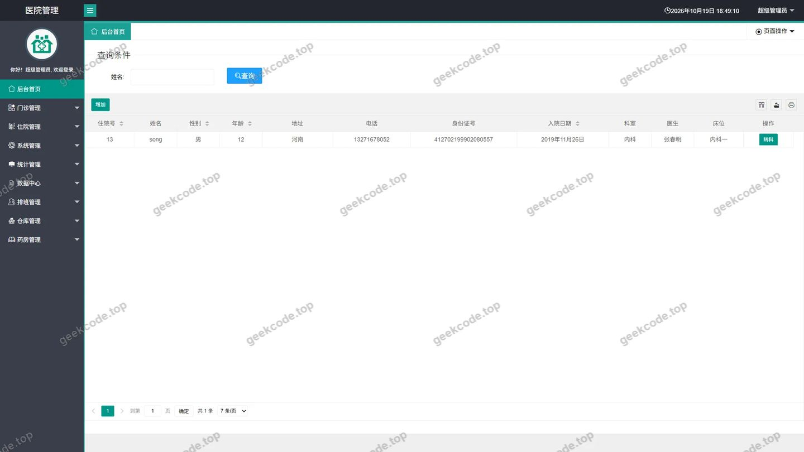</a>

<h4>页面-项目划价</h4>

<a href="https://geekcode.top/archives/java%E9%A1%B9%E7%9B%AE25%E6%9C%9F%E5%9F%BA%E4%BA%8Espringboot-layui%E5%AE%9E%E7%8E%B0%E7%9A%84%E5%8C%BB%E9%99%A2?utm_source=github" title="查看完整源码">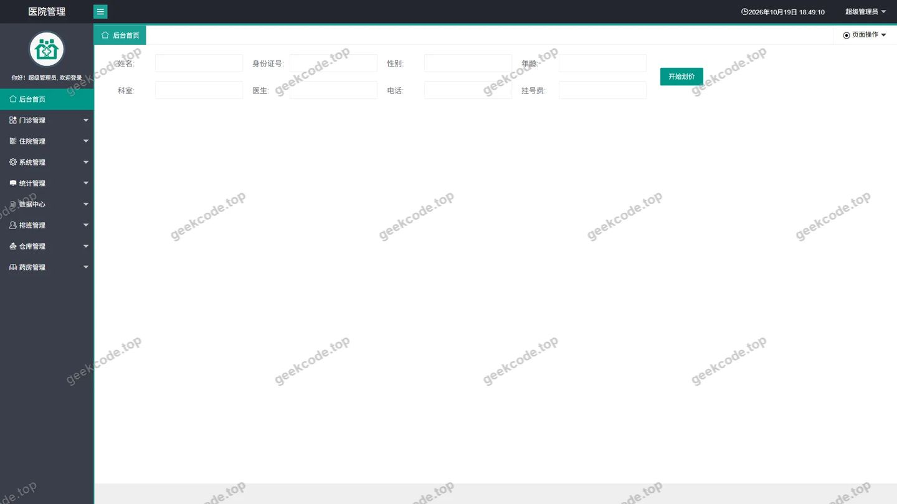</a>

<h4>页面-处方划价</h4>

<a href="https://geekcode.top/archives/java%E9%A1%B9%E7%9B%AE25%E6%9C%9F%E5%9F%BA%E4%BA%8Espringboot-layui%E5%AE%9E%E7%8E%B0%E7%9A%84%E5%8C%BB%E9%99%A2?utm_source=github" title="查看完整源码">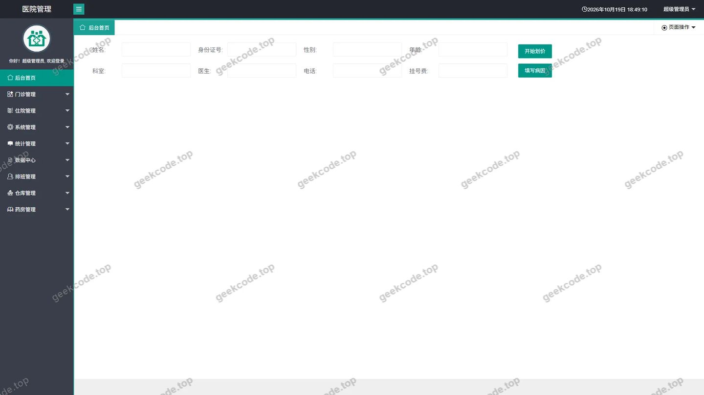</a>

<h4>页面-门诊患者库</h4>

<a href="https://geekcode.top/archives/java%E9%A1%B9%E7%9B%AE25%E6%9C%9F%E5%9F%BA%E4%BA%8Espringboot-layui%E5%AE%9E%E7%8E%B0%E7%9A%84%E5%8C%BB%E9%99%A2?utm_source=github" title="查看完整源码">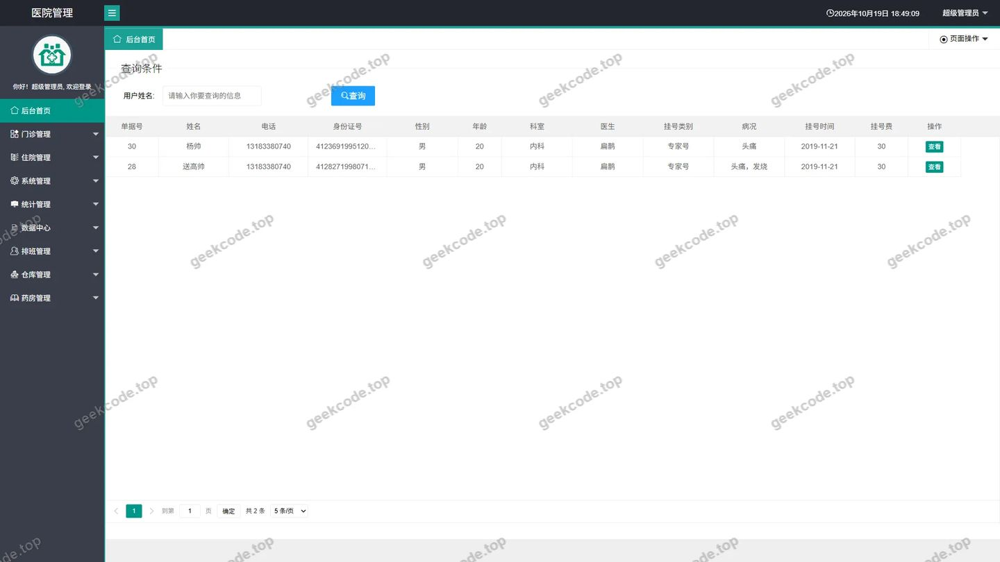</a>

<h4>页面-项目检查</h4>

<a href="https://geekcode.top/archives/java%E9%A1%B9%E7%9B%AE25%E6%9C%9F%E5%9F%BA%E4%BA%8Espringboot-layui%E5%AE%9E%E7%8E%B0%E7%9A%84%E5%8C%BB%E9%99%A2?utm_source=github" title="查看完整源码">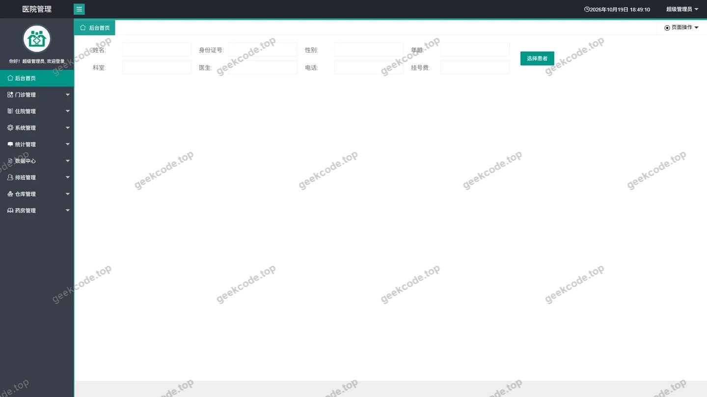</a>

<h4>页面-后台首页</h4>

<a href="https://geekcode.top/archives/java%E9%A1%B9%E7%9B%AE25%E6%9C%9F%E5%9F%BA%E4%BA%8Espringboot-layui%E5%AE%9E%E7%8E%B0%E7%9A%84%E5%8C%BB%E9%99%A2?utm_source=github" title="查看完整源码">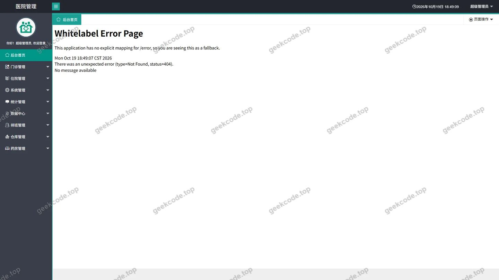</a>

<h4>页面-用户挂号</h4>

<a href="https://geekcode.top/archives/java%E9%A1%B9%E7%9B%AE25%E6%9C%9F%E5%9F%BA%E4%BA%8Espringboot-layui%E5%AE%9E%E7%8E%B0%E7%9A%84%E5%8C%BB%E9%99%A2?utm_source=github" title="查看完整源码">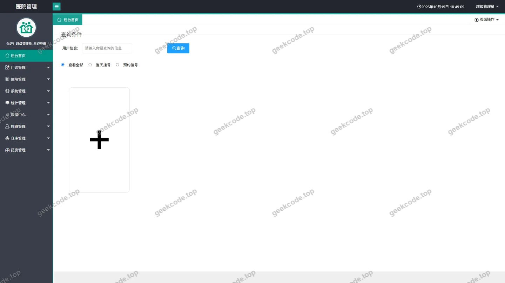</a>

<h4>页面-checkup</h4>

<a href="https://geekcode.top/archives/java%E9%A1%B9%E7%9B%AE25%E6%9C%9F%E5%9F%BA%E4%BA%8Espringboot-layui%E5%AE%9E%E7%8E%B0%E7%9A%84%E5%8C%BB%E9%99%A2?utm_source=github" title="查看完整源码">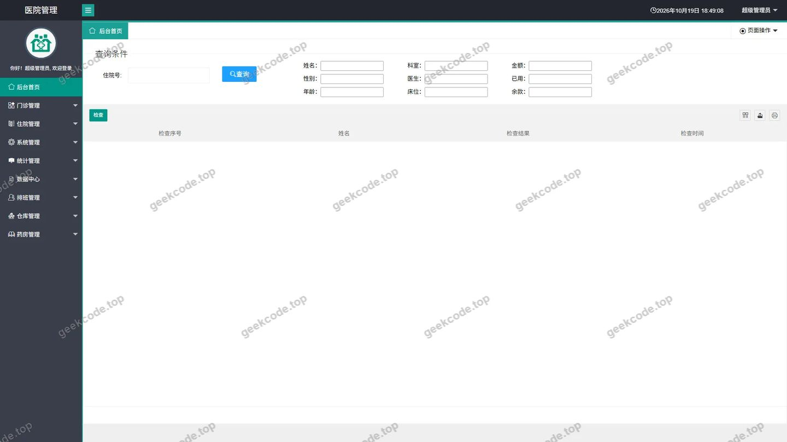</a>

<h4>页面-drug</h4>

<a href="https://geekcode.top/archives/java%E9%A1%B9%E7%9B%AE25%E6%9C%9F%E5%9F%BA%E4%BA%8Espringboot-layui%E5%AE%9E%E7%8E%B0%E7%9A%84%E5%8C%BB%E9%99%A2?utm_source=github" title="查看完整源码">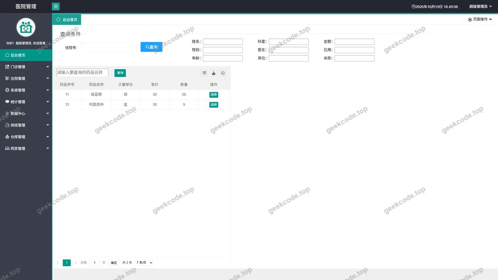</a>

<h4>页面-item</h4>

<a href="https://geekcode.top/archives/java%E9%A1%B9%E7%9B%AE25%E6%9C%9F%E5%9F%BA%E4%BA%8Espringboot-layui%E5%AE%9E%E7%8E%B0%E7%9A%84%E5%8C%BB%E9%99%A2?utm_source=github" title="查看完整源码">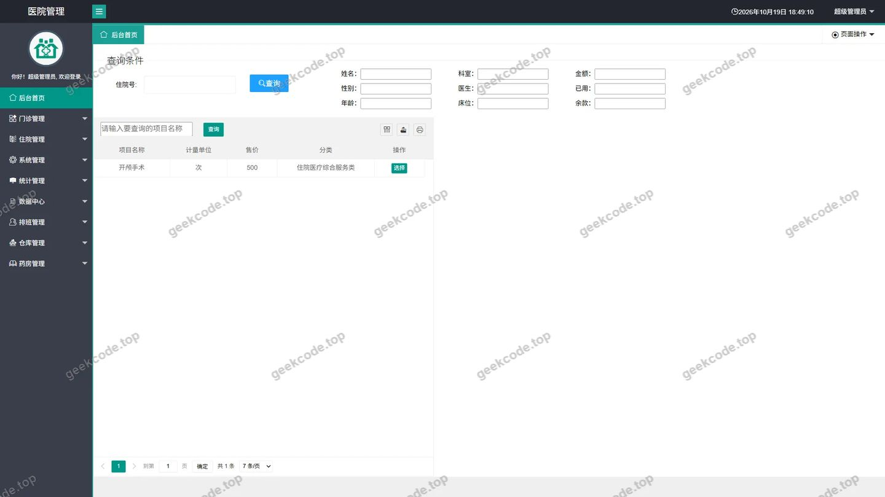</a>

<h4>页面-leave</h4>

<a href="https://geekcode.top/archives/java%E9%A1%B9%E7%9B%AE25%E6%9C%9F%E5%9F%BA%E4%BA%8Espringboot-layui%E5%AE%9E%E7%8E%B0%E7%9A%84%E5%8C%BB%E9%99%A2?utm_source=github" title="查看完整源码">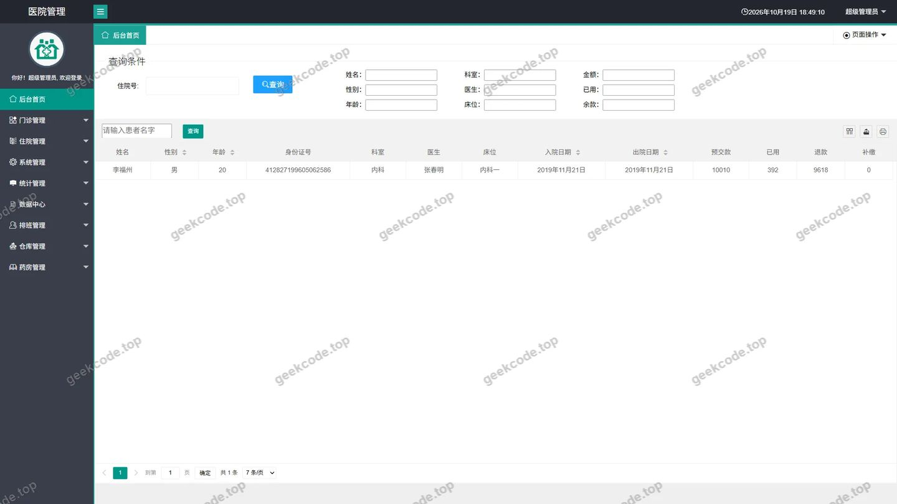</a>

<h4>页面-pay</h4>

<a href="https://geekcode.top/archives/java%E9%A1%B9%E7%9B%AE25%E6%9C%9F%E5%9F%BA%E4%BA%8Espringboot-layui%E5%AE%9E%E7%8E%B0%E7%9A%84%E5%8C%BB%E9%99%A2?utm_source=github" title="查看完整源码">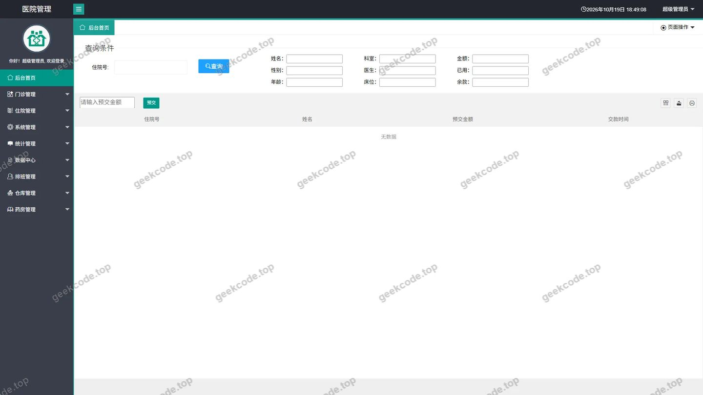</a>

<h4>页面-pharmacy</h4>

<a href="https://geekcode.top/archives/java%E9%A1%B9%E7%9B%AE25%E6%9C%9F%E5%9F%BA%E4%BA%8Espringboot-layui%E5%AE%9E%E7%8E%B0%E7%9A%84%E5%8C%BB%E9%99%A2?utm_source=github" title="查看完整源码">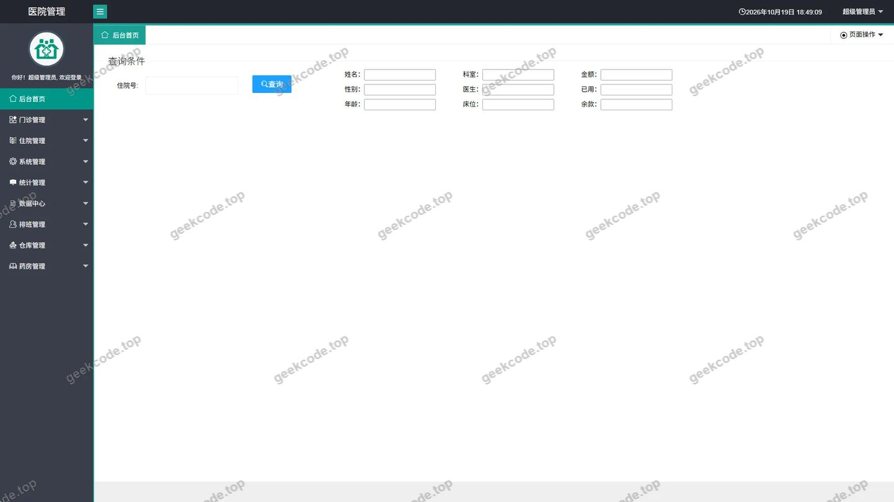</a>

<h4>页面-to首页</h4>

<a href="https://geekcode.top/archives/java%E9%A1%B9%E7%9B%AE25%E6%9C%9F%E5%9F%BA%E4%BA%8Espringboot-layui%E5%AE%9E%E7%8E%B0%E7%9A%84%E5%8C%BB%E9%99%A2?utm_source=github" title="查看完整源码">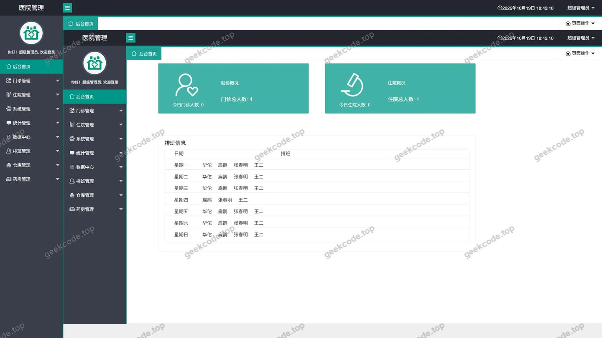</a>

<h4>页面-to医生</h4>

<a href="https://geekcode.top/archives/java%E9%A1%B9%E7%9B%AE25%E6%9C%9F%E5%9F%BA%E4%BA%8Espringboot-layui%E5%AE%9E%E7%8E%B0%E7%9A%84%E5%8C%BB%E9%99%A2?utm_source=github" title="查看完整源码">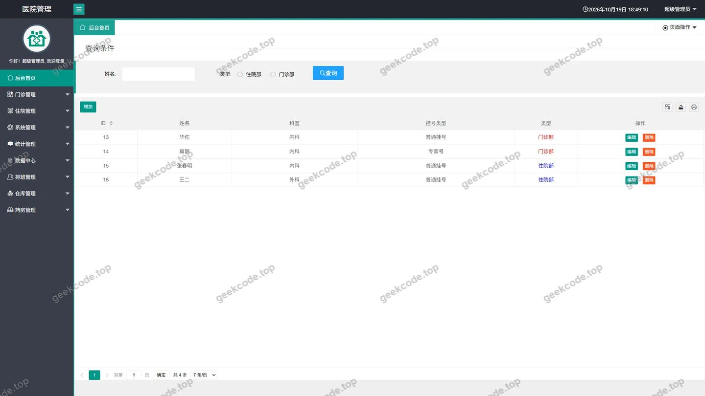</a>

<h4>页面-toLoadAllRole</h4>

<a href="https://geekcode.top/archives/java%E9%A1%B9%E7%9B%AE25%E6%9C%9F%E5%9F%BA%E4%BA%8Espringboot-layui%E5%AE%9E%E7%8E%B0%E7%9A%84%E5%8C%BB%E9%99%A2?utm_source=github" title="查看完整源码">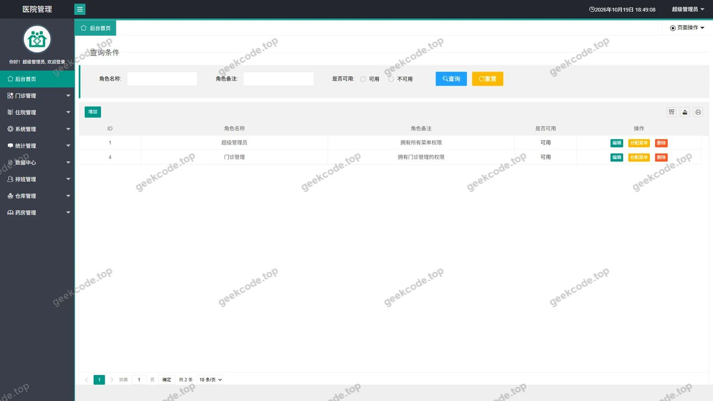</a>

<h4>页面-toLoadAll用户</h4>

<a href="https://geekcode.top/archives/java%E9%A1%B9%E7%9B%AE25%E6%9C%9F%E5%9F%BA%E4%BA%8Espringboot-layui%E5%AE%9E%E7%8E%B0%E7%9A%84%E5%8C%BB%E9%99%A2?utm_source=github" title="查看完整源码">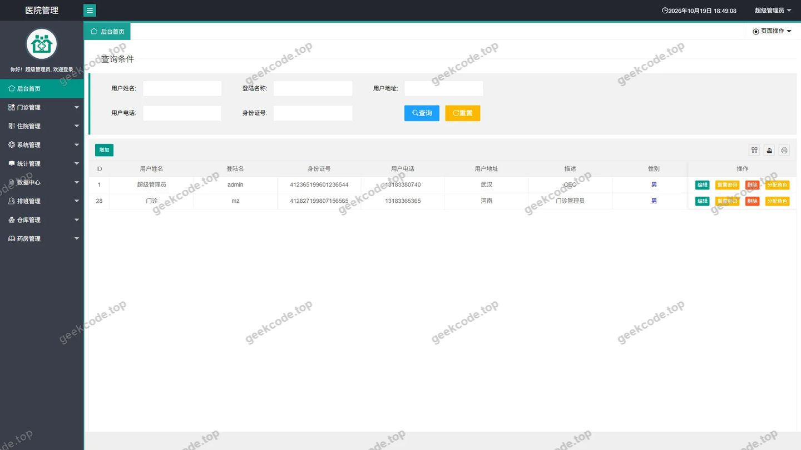</a>

<h4>页面-toMenuLeft</h4>

<a href="https://geekcode.top/archives/java%E9%A1%B9%E7%9B%AE25%E6%9C%9F%E5%9F%BA%E4%BA%8Espringboot-layui%E5%AE%9E%E7%8E%B0%E7%9A%84%E5%8C%BB%E9%99%A2?utm_source=github" title="查看完整源码">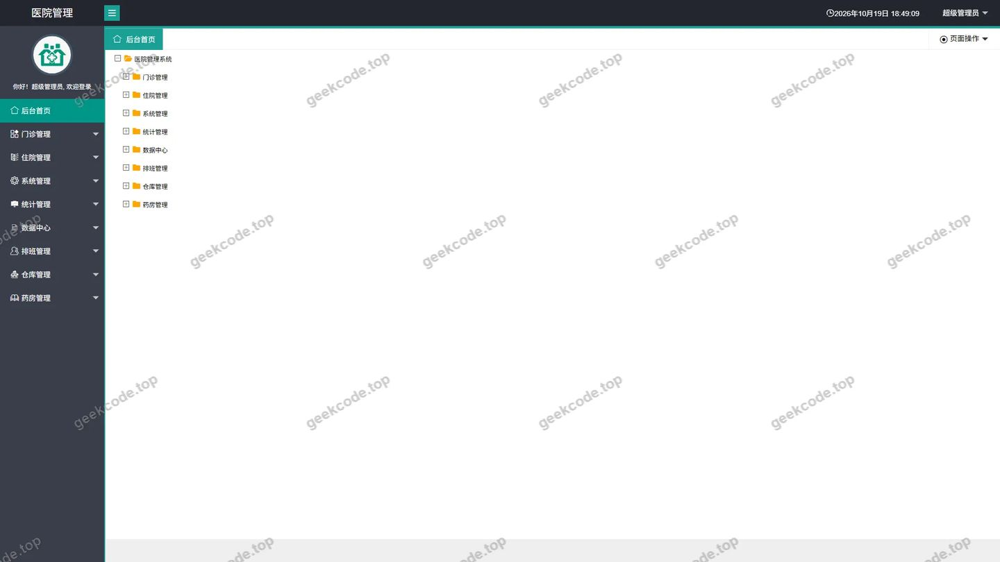</a>

<h4>页面-toMenuRight</h4>

<a href="https://geekcode.top/archives/java%E9%A1%B9%E7%9B%AE25%E6%9C%9F%E5%9F%BA%E4%BA%8Espringboot-layui%E5%AE%9E%E7%8E%B0%E7%9A%84%E5%8C%BB%E9%99%A2?utm_source=github" title="查看完整源码">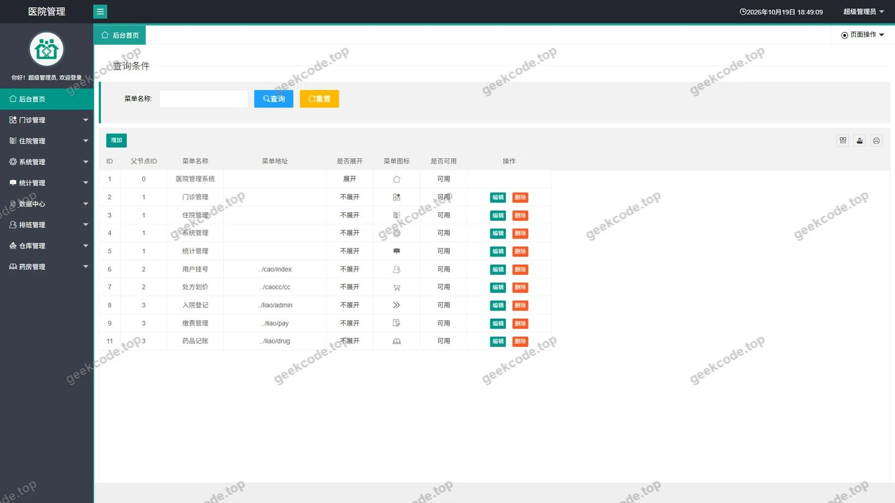</a>

---

## 获取完整源码

| 项目 | 说明 |
| --- | --- |
| 项目名 | java项目25期基于springboot+layui实现的医院 |
| 运行截图 | 本文 20 张（站点带水印原图，仓库 `images/` 目录） |
| 完整源码 | [https://geekcode.top/archives/java%E9%A1%B9%E7%9B%AE25%E6%9C%9F%E5%9F%BA%E4%BA%8Espringboot-layui%E5%AE%9E%E7%8E%B0%E7%9A%84%E5%8C%BB%E9%99%A2?utm_source=github](https://geekcode.top/archives/java%E9%A1%B9%E7%9B%AE25%E6%9C%9F%E5%9F%BA%E4%BA%8Espringboot-layui%E5%AE%9E%E7%8E%B0%E7%9A%84%E5%8C%BB%E9%99%A2?utm_source=github) |
| 咨询微信 | **ir9372**（备注：jingpin-yuanma） |
| 更多项目 | [极客代码 geekcode.top](https://geekcode.top/?utm_source=github) |

> 需要源码、部署、改配置、跑不起来等问题，加微信 ir9372 沟通，说明项目名即可。
